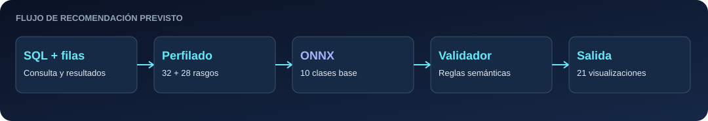
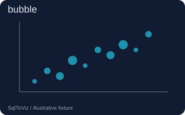
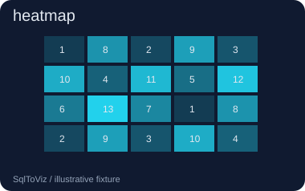
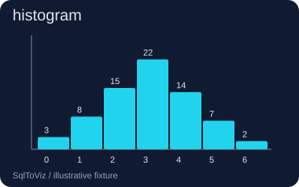
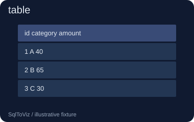

<p align="center"></p>

<p align="center"><a href="README.md">English</a> · <a href="README.es.md">Español</a> · <a href="docs/roadmap.md">Roadmap</a> · <a href="spec/chart-taxonomy-v1.md">SqlVizSpec</a> · <a href="examples/charts">Examples</a></p>

<p align="center"><a href="https://pypi.org/project/sqltoviz/"></a> <a href="https://www.npmjs.com/package/sqltoviz"></a> <a href="https://www.nuget.org/packages/SqlToViz"></a>  </p>

> [!NOTE]
> Alfa: los SDK de Python, TypeScript y .NET están publicados como `0.1.0a2` / `0.1.0-alpha.2` con una vista previa determinista y modelos ONNX **experimentales** (candidatos sin validación humana). La galería ilustra datos sintéticos. [Probar el playground](https://jmmana.github.io/sqltoviz/#play) · [Documentación](https://jmmana.github.io/sqltoviz/docs/).


*El playground en el navegador: elige o pega una consulta, analiza y obtén el gráfico recomendado y por qué (grabación del sitio publicado; el plan es la vista previa por reglas, los modelos son experimentales).*

## ¿Por qué SqlToViz?

Una aplicación de BI o Text-to-SQL ya conoce la consulta que ejecutó y sus resultados. Sin embargo, elegir una visualización adecuada requiere interpretar dimensiones, medidas, agregaciones, unidades y granularidad. Una gráfica atractiva puede ser matemáticamente incorrecta si mezcla promedios o duplica totales.

**SqlToViz** propone conservar el contexto de la consulta y combinarlo con el perfil estadístico de las filas. La recomendación se especializa y valida antes de producir un plan visual explicable. No ejecuta SQL ni sustituye el control de acceso a la base de datos: recibe la consulta y los resultados de la aplicación anfitriona.

| Para quién | Aplicación prevista |
|---|---|
| Desarrolladores BI | Elegir gráficos para paneles dinámicos |
| Agentes Text-to-SQL | Convertir resultados en visualizaciones sin una segunda llamada a un LLM |
| Equipos .NET, Python y JS | Integrar un contrato compartido con inferencia local |
| Investigadores | Evaluar el aporte del contexto SQL y la validación semántica |

## Cómo funciona



El modelo propone; las reglas comprueban. La extracción léxico-estructural SQL no equivale a un parser AST completo. Se prevén 16 rasgos SQL, 16 globales de datos y 28 por columna, sujetos a congelación del contrato. El clasificador propone diez clases base; el resolvedor puede especializarlas a 21 salidas. Si faltan metadatos imprescindibles, el validador debe rechazar la alternativa arriesgada y considerar otra o una tabla.

## Explora 21 visualizaciones

Pulsa cualquier imagen para consultar SQL, filas, metadatos y gráfico esperado. Los ejemplos documentan el comportamiento previsto, no predicciones del modelo.

### Resumen ejecutivo

| **kpi — Ingresos totales** | **gauge — Cumplimiento de meta** |
| :---: | :---: |
| [](examples/charts/kpi.json) | [](examples/charts/gauge.json) |
| Un valor responde una pregunta de negocio. | Una meta y rango conocidos hacen interpretable el progreso. |

### Comparación

| **bar — Comparación de categorías** | **horizontal_bar — Ranking** |
| :---: | :---: |
| [](examples/charts/bar.json) | [](examples/charts/horizontal_bar.json) |
| Compara magnitudes desde una base común. | Lee categorías ordenadas y etiquetas largas. |

| **grouped_bar — Comparar segmentos** | **stacked_bar — Composición por grupo** |
| :---: | :---: |
| [](examples/charts/grouped_bar.json) | [](examples/charts/stacked_bar.json) |
| Compara promedios lado a lado sin sumarlos. | Suma componentes disjuntos y aditivos en unidades comunes. |

| **waterfall — Descomposición del cambio** |
| :---: |
| [](examples/charts/waterfall.json) |
| Sigue aportes con signo desde el saldo inicial al final. |

### Tiempo y tendencias

| **line — Evolución temporal** | **area — Volumen en el tiempo** |
| :---: | :---: |
| [](examples/charts/line.json) | [](examples/charts/area.json) |
| Revela cambios entre observaciones ordenadas. | Destaca magnitud con una base significativa. |

| **stacked_area — Composición cambiante** | **combo_dual_axis — Ingresos y pedidos** |
| :---: | :---: |
| [](examples/charts/stacked_area.json) | [](examples/charts/combo_dual_axis.json) |
| Sigue series aditivas alineadas en el tiempo. | Usa unidades explícitas y ejes etiquetados solo si se justifica. |

### Parte-todo y jerarquía

| **donut — Participación del total** | **treemap — Composición de portafolio** |
| :---: | :---: |
| [](examples/charts/donut.json) | [](examples/charts/treemap.json) |
| Muestra partes excluyentes no negativas de un total positivo. | Compara pesos jerárquicos aditivos mediante área. |

| **sunburst — Participaciones anidadas** |
| :---: |
| [](examples/charts/sunburst.json) |
| Explora una jerarquía padre-hijo validada. |

### Relaciones

| **scatter — Costo frente a ingresos** | **bubble — Relación con volumen** |
| :---: | :---: |
| [](examples/charts/scatter.json) | [](examples/charts/bubble.json) |
| Examina observaciones cuantitativas pareadas. | Representa una tercera medida no negativa con el área del marcador. |

### Distribución y matrices

| **heatmap — Actividad por día y hora** | **histogram — Distribución de frecuencias** |
| :---: | :---: |
| [](examples/charts/heatmap.json) | [](examples/charts/histogram.json) |
| Expone patrones entre dos dimensiones discretas. | Usa muestras o intervalos de frecuencia válidos y ordenados. |

| **boxplot — Dispersión por grupo** | **violin — Densidad por grupo** |
| :---: | :---: |
| [](examples/charts/boxplot.json) | [](examples/charts/violin.json) |
| Compara cuantiles con semántica de bigotes declarada. | Estima la forma de la distribución con muestras suficientes. |

### Detalle y respaldo

| **table — Detalle de transacciones** |
| :---: |
| [](examples/charts/table.json) |
| Conserva las filas exactas cuando un gráfico no es adecuado. |

## De SQL a un plan de visualización

```sql
SELECT category, SUM(amount) AS value
FROM sales
GROUP BY category;
```

```json
[{"category":"A","value":40},{"category":"B","value":65},
 {"category":"C","value":30},{"category":"D","value":50}]
```


Plan ilustrativo esperado (no es una respuesta ejecutada del SDK):

```json
{"chartType":"bar","encodings":{"x":{"field":"category"},"y":{"field":"value"}}}
```

Una dimensión categórica y una medida cuantitativa hacen razonable una gráfica de barras. Otra alternativa podría ser válida; este fixture documenta una respuesta prevista.

## Seguridad semántica: por qué importa elegir bien

| Escenario | Incorrecto o sin evidencia | Comportamiento esperado |
|---|---|---|
| AVG by segment | stacked_bar | grouped_bar |
| COUNT DISTINCT | Sumar grupos solapados | Exigir disjunción o rechazar apilado |
| Gauge | Inventar meta | Exigir meta explícita |
| Donut | Partes negativas o solapadas | Elegir alternativa admisible |


Por ejemplo, recombinar dos promedios exige sus denominadores; sumarlos no representa un total válido. El validador previsto expone motivos de rechazo en lugar de producir una gráfica engañosa.

## Hallazgos estadísticos

| Detector | Hallazgo previsto |
|---|---|
| Modified Z-score / MAD | Atípicos puntuales; tratamiento explícito de MAD cero |
| Period shift | Comparar último periodo con base anterior |
| Pareto | Concentración de aportes no negativos |
| Pearson | Asociación lineal, no causalidad |

Los hallazgos se calcularán desde los datos, no mediante un LLM. Los umbrales y limitaciones deben validarse.

## Instalación y uso

```bash
pip install --pre sqltoviz          # Python 3.10+
npm install sqltoviz@alpha          # Node.js 20+
dotnet add package SqlToViz --prerelease   # .NET 8 / 10
```

```python
from sqltoviz import recommend
plan = recommend("SELECT 42 AS total", [{"total": 42}])
assert plan["chartType"] == "kpi"
```

```javascript
import { recommend } from 'sqltoviz';
const plan = recommend('SELECT 42 AS total', [{ total: 42 }]);
```

```csharp
var plan = SqlToViz.Preview.Recommend("SELECT 42 AS total",
    new[] { new Dictionary<string, object?> { ["total"] = 42 } });
```

Los modelos ONNX incluidos son candidatos **experimentales** entrenados con datos sintéticos y 322 columnas de Vega-Lite; no tienen validación humana. Detalles: [guía de los SDK](https://jmmana.github.io/sqltoviz/docs/es/sdk.html).

## Investigación y reproducibilidad

Hipótesis: el contexto SQL mejora las recomendaciones frente al perfilado de datos aislado. Comparar modelos solo datos, solo SQL, fusión, reglas e híbrido con particiones agrupadas independientes. Medir Macro-F1, roles, violaciones semánticas, cobertura de respaldo, paridad y latencia de inferencia y extremo a extremo por separado. Aún no hay resultados medidos ni identificador arXiv.

[Kaggle](research/kaggle/README.md) · [Paper](research/paper/README.md) · [Parity](parity/README.md)

## Ruta de desarrollo

Las listas de issues son la fuente de verdad; registrar no equivale a completar.

| Epic | Enfoque |
|---|---|
| [E00](https://github.com/jmmana/sqltoviz/issues/1) | Foundation |
| [E01](https://github.com/jmmana/sqltoviz/issues/2) | Kaggle |
| [E02](https://github.com/jmmana/sqltoviz/issues/3) | SqlVizSpec |
| [E03](https://github.com/jmmana/sqltoviz/issues/4) | Python |
| [E04](https://github.com/jmmana/sqltoviz/issues/5) | TypeScript |
| [E05](https://github.com/jmmana/sqltoviz/issues/6) | .NET |
| [E06](https://github.com/jmmana/sqltoviz/issues/7) | Web & branding |
| [E07](https://github.com/jmmana/sqltoviz/issues/8) | CI/CD |
| [E08](https://github.com/jmmana/sqltoviz/issues/9) | Research |
| [E09](https://github.com/jmmana/sqltoviz/issues/10) | Release |

[Roadmap](docs/roadmap.md) · [Issues](https://github.com/jmmana/sqltoviz/issues) · [Contributing](CONTRIBUTING.md)

Licencia Apache-2.0 prevista; texto pendiente. Por ahora cita la URL del repositorio; referencia del artículo pendiente.
