<p align="center"><picture><source media="(prefers-color-scheme: dark)" srcset="docs/assets/logo-dark.svg"></picture></p>
<p align="center">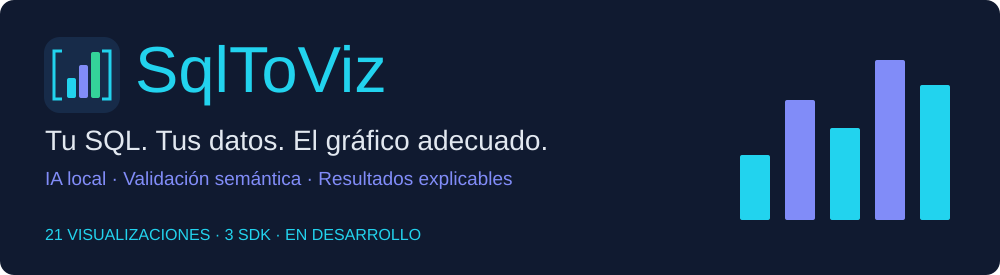</p>

<p align="center"><a href="README.md">English</a> · <a href="README.es.md">Español</a> · <a href="docs/roadmap.md">Roadmap</a> · <a href="spec/chart-taxonomy-v1.md">SqlVizSpec</a></p>

   

> **Pre-alfa: imágenes ilustrativas, no ejecuciones del SDK. Modelo, paquetes y playground pendientes.**

## Qué es SqlToViz

Proyecto de recomendación visual a partir de SQL y filas resultantes, con inferencia ONNX local y validación semántica determinista.

## Galería de 21 visualizaciones

Cada imagen enlaza al fixture con SQL, filas sintéticas, metadatos, salida esperada y explicación.

| **kpi** | **gauge** | **bar** |
| :---: | :---: | :---: |
| [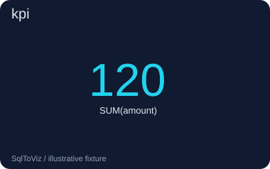](examples/charts/kpi.json) | [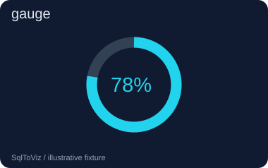](examples/charts/gauge.json) | [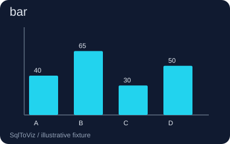](examples/charts/bar.json) |
| Agregado escalar | Objetivo y rango explícitos | Comparación categórica |

| **horizontal_bar** | **grouped_bar** | **stacked_bar** |
| :---: | :---: | :---: |
| [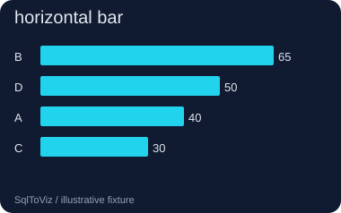](examples/charts/horizontal_bar.json) | [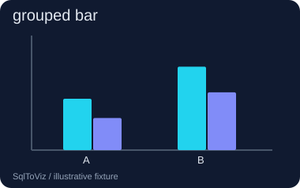](examples/charts/grouped_bar.json) | [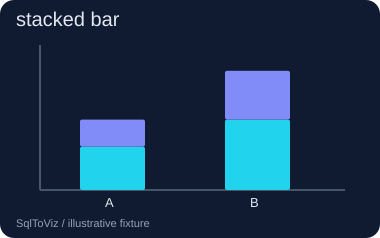](examples/charts/stacked_bar.json) |
| Ranking ordenado | Comparar promedios sin apilar | Segmentos aditivos disjuntos |

| **waterfall** | **line** | **area** |
| :---: | :---: | :---: |
| [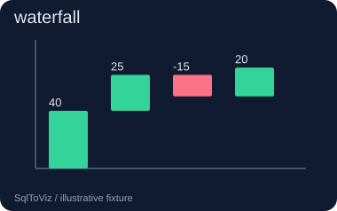](examples/charts/waterfall.json) | [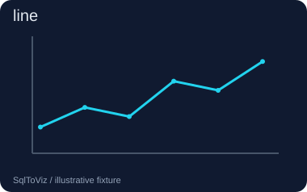](examples/charts/line.json) | [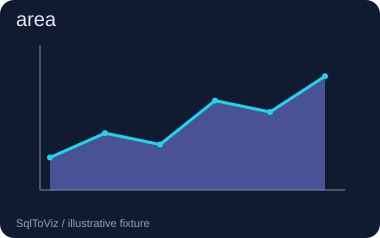](examples/charts/area.json) |
| Variaciones ordenadas conciliables | Tendencia temporal ordenada | Magnitud con base cero |

| **stacked_area** | **combo_dual_axis** | **donut** |
| :---: | :---: | :---: |
| [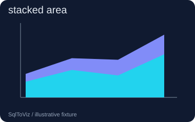](examples/charts/stacked_area.json) | [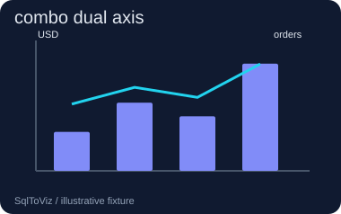](examples/charts/combo_dual_axis.json) | [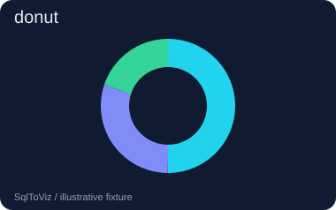](examples/charts/donut.json) |
| Series aditivas alineadas | Dos unidades y escalas explícitas | Partes exclusivas y total positivo |

| **treemap** | **sunburst** | **scatter** |
| :---: | :---: | :---: |
| [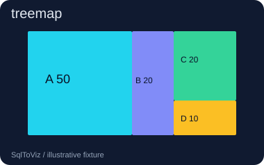](examples/charts/treemap.json) | [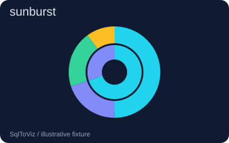](examples/charts/sunburst.json) | [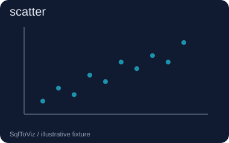](examples/charts/scatter.json) |
| Jerarquía validada | Jerarquía proporcional anidada | Valores cuantitativos pareados |

| **bubble** | **heatmap** | **histogram** |
| :---: | :---: | :---: |
| [](examples/charts/bubble.json) | [](examples/charts/heatmap.json) | [](examples/charts/histogram.json) |
| Tercera métrica en área | Dos dimensiones discretas | Intervalos ordenados de igual ancho |

| **boxplot** | **violin** | **table** |
| :---: | :---: | :---: |
| [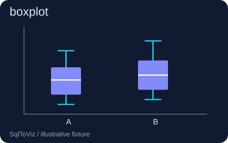](examples/charts/boxplot.json) | [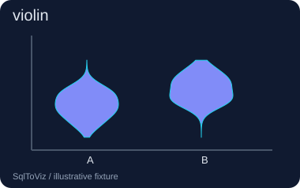](examples/charts/violin.json) | [](examples/charts/table.json) |
| Resumen de cinco números | Densidad muestral con KDE gaussiana | Detalle o respaldo |

## Ejemplo

```sql
SELECT category,SUM(amount) AS value FROM sales GROUP BY category;
```

```json
[
  {
    "category": "A",
    "value": 40
  },
  {
    "category": "B",
    "value": 65
  },
  {
    "category": "C",
    "value": 30
  },
  {
    "category": "D",
    "value": 50
  }
]
```

Salida esperada, no ejecutada: `{"chartType":"bar"}`.

## Arquitectura

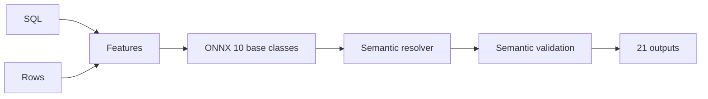

## SDK: interfaces previstas

APIs propuestas, aún no verificadas ni publicadas.

```python
from sqltoviz import analyze_query
plan = analyze_query(sql=sql, rows=rows)
```

```typescript
import { analyzeQuery } from '@sqltoviz/core';
const plan = await analyzeQuery({ sql, rows });
```

```csharp
using SqlToViz;
using var engine = new VizEngine();
var plan = engine.Analyze(sql, rows);
```

## Seguridad semántica

No apilar promedios sin recomposición válida. No sumar COUNT DISTINCT sin disjunción demostrada. Gauge exige objetivo; boxplot exige cuantiles o muestras. [Spec](spec/chart-taxonomy-v1.md).

## Investigación y benchmarks

MAD, cambio temporal, Pareto y Pearson planificados. Se evaluarán Macro-F1, cobertura, violaciones semánticas y latencia p50/p99. No hay resultados medidos ni preprint publicado.

[Kaggle](research/kaggle/README.md) · [Paper](research/paper/README.md)

## Progreso y contribución

[Roadmap](docs/roadmap.md) · [Issues](https://github.com/jmmana/sqltoviz/issues) · [Contributing](CONTRIBUTING.md)

Licencia prevista Apache-2.0; texto pendiente.
