<p align="center"><picture><source media="(prefers-color-scheme: dark)" srcset="docs/assets/logo-dark.svg"></picture></p>
<p align="center"></p>

<p align="center"><a href="README.md">English</a> · <a href="README.es.md">Español</a> · <a href="docs/roadmap.md">Roadmap</a> · <a href="spec/chart-taxonomy-v1.md">SqlVizSpec</a></p>

   

> **Pre-alpha: illustrative images, not SDK executions. Model, packages and playground pending.**

## What is SqlToViz?

Query-aware visualization recommendation from SQL and result rows, with planned local ONNX inference and deterministic semantic validation.

## 21 visualization gallery

Each image links to a fixture with SQL, synthetic rows, metadata, expected output and explanation.

| **kpi** | **gauge** | **bar** |
| :---: | :---: | :---: |
| [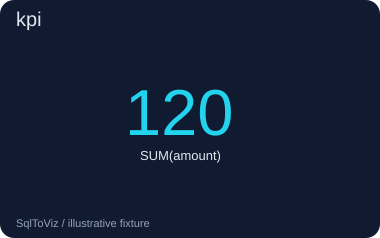](examples/charts/kpi.json) | [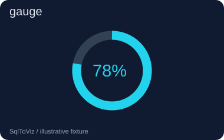](examples/charts/gauge.json) | [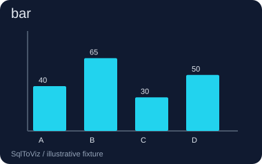](examples/charts/bar.json) |
| Scalar aggregate | Explicit target and range | Categorical comparison |

| **horizontal_bar** | **grouped_bar** | **stacked_bar** |
| :---: | :---: | :---: |
| [](examples/charts/horizontal_bar.json) | [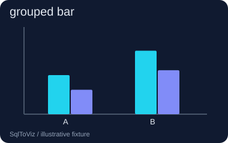](examples/charts/grouped_bar.json) | [](examples/charts/stacked_bar.json) |
| Ordered ranking | Compare averages without stacking | Additive disjoint segments |

| **waterfall** | **line** | **area** |
| :---: | :---: | :---: |
| [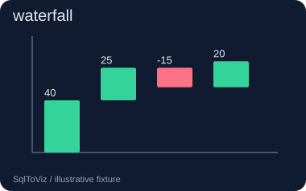](examples/charts/waterfall.json) | [](examples/charts/line.json) | [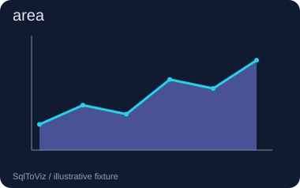](examples/charts/area.json) |
| Ordered reconciled changes | Ordered temporal trend | Magnitude with zero baseline |

| **stacked_area** | **combo_dual_axis** | **donut** |
| :---: | :---: | :---: |
| [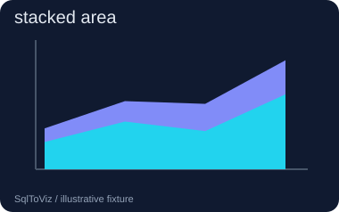](examples/charts/stacked_area.json) | [](examples/charts/combo_dual_axis.json) | [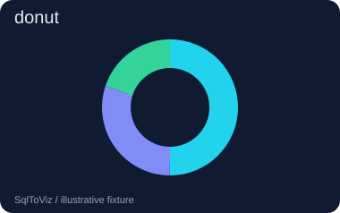](examples/charts/donut.json) |
| Aligned additive series | Two explicit units and scales | Exclusive positive total |

| **treemap** | **sunburst** | **scatter** |
| :---: | :---: | :---: |
| [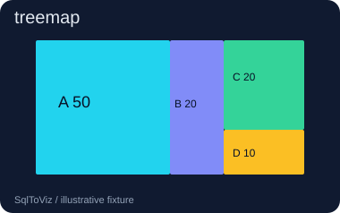](examples/charts/treemap.json) | [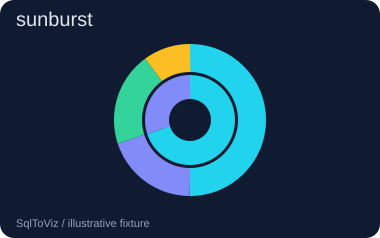](examples/charts/sunburst.json) | [](examples/charts/scatter.json) |
| Validated hierarchy | Nested proportional hierarchy | Paired quantitative values |

| **bubble** | **heatmap** | **histogram** |
| :---: | :---: | :---: |
| [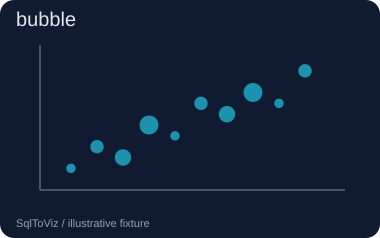](examples/charts/bubble.json) | [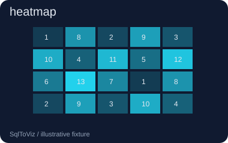](examples/charts/heatmap.json) | [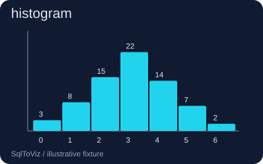](examples/charts/histogram.json) |
| Third measure mapped to area | Two discrete dimensions | Equal-width ordered bins |

| **boxplot** | **violin** | **table** |
| :---: | :---: | :---: |
| [](examples/charts/boxplot.json) | [](examples/charts/violin.json) | [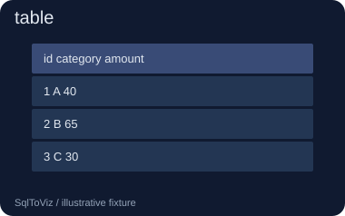](examples/charts/table.json) |
| Five-number summary | Sample density with Gaussian KDE | Detail or fallback |

## Example

```sql
SELECT category,SUM(amount) AS value FROM sales GROUP BY category;
```

```json
[
  {
    "category": "A",
    "value": 40
  },
  {
    "category": "B",
    "value": 65
  },
  {
    "category": "C",
    "value": 30
  },
  {
    "category": "D",
    "value": 50
  }
]
```

Expected output, not executed: `{"chartType":"bar"}`.

## Architecture

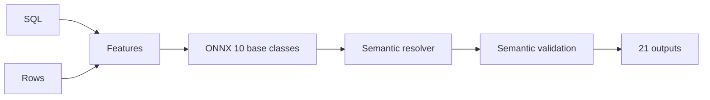

## SDKs: intended interfaces

Proposed APIs, not yet verified or published.

```python
from sqltoviz import analyze_query
plan = analyze_query(sql=sql, rows=rows)
```

```typescript
import { analyzeQuery } from '@sqltoviz/core';
const plan = await analyzeQuery({ sql, rows });
```

```csharp
using SqlToViz;
using var engine = new VizEngine();
var plan = engine.Analyze(sql, rows);
```

## Semantic safety

Do not stack averages without valid recomposition. Do not sum COUNT DISTINCT without proven disjointness. Gauge requires a target; boxplot requires quantiles or samples. [Spec](spec/chart-taxonomy-v1.md).

## Research and benchmarks

MAD, period shift, Pareto and Pearson planned. Evaluation targets: macro-F1, coverage, semantic violations and p50/p99 latency. No measured results or published preprint.

[Kaggle](research/kaggle/README.md) · [Paper](research/paper/README.md)

## Progress and contribution

[Roadmap](docs/roadmap.md) · [Issues](https://github.com/jmmana/sqltoviz/issues) · [Contributing](CONTRIBUTING.md)

Apache-2.0 planned; license text pending.
