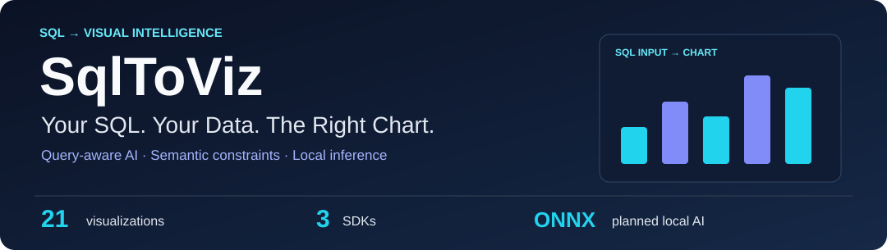
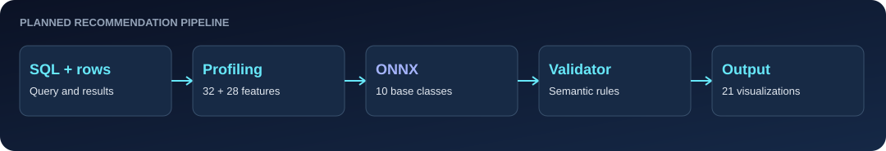
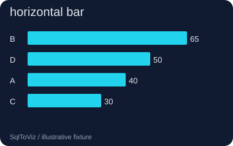
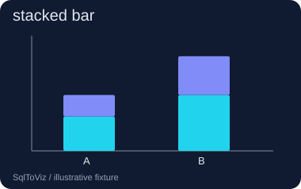
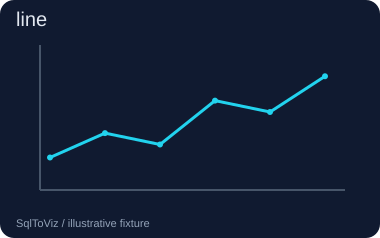
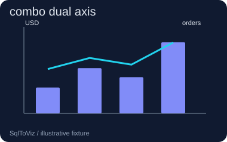
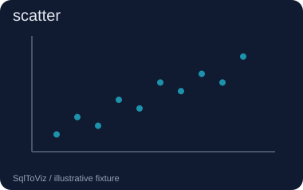
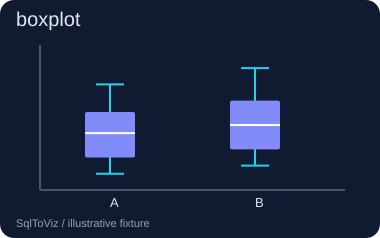
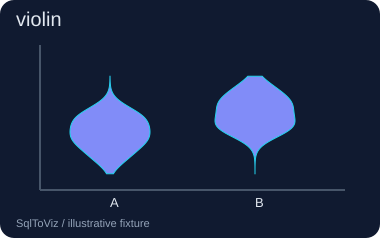

<p align="center"></p>

<p align="center"><a href="README.md">English</a> · <a href="README.es.md">Español</a> · <a href="docs/roadmap.md">Roadmap</a> · <a href="spec/chart-taxonomy-v1.md">SqlVizSpec</a> · <a href="examples/charts">Examples</a></p>

<p align="center"><a href="https://pypi.org/project/sqltoviz/"></a> <a href="https://www.npmjs.com/package/sqltoviz"></a> <a href="https://www.nuget.org/packages/SqlToViz"></a>  </p>

> [!NOTE]
> Alpha: the Python, TypeScript and .NET SDKs are published as `0.1.0a2` / `0.1.0-alpha.2` with a deterministic preview and **experimental** ONNX models (candidates, no human validation). The gallery is illustrated from synthetic fixtures. [Try the playground](https://jmmana.github.io/sqltoviz/#play) · [Documentation](https://jmmana.github.io/sqltoviz/docs/).


*The playground running in the browser: pick or paste a query, analyze, get the recommended chart and why (live recording of the published site; the plan is rule-based preview, models are experimental).*

## Why SqlToViz?

A BI or Text-to-SQL application already knows the executed query and its result rows. Yet selecting an appropriate visualization requires understanding dimensions, measures, aggregation, units and grain. A polished chart can be mathematically wrong when it stacks unrelated averages or double-counts totals.

**SqlToViz** proposes combining query context with statistical row profiles. Recommendations are specialized and validated before producing an explainable visualization plan. It does not execute SQL or replace database access controls: the host application supplies the query and result rows.

| Audience | Intended use |
|---|---|
| BI developers | Dynamic dashboard recommendations |
| Text-to-SQL agents | Visualize results without a second LLM call |
| Python, JavaScript and .NET teams | Shared contract with local inference |
| Researchers | Evaluate query context and semantic validation |

## How it works



The model proposes; deterministic rules check. SQL lexical-structural extraction is not a full AST parser. The draft contract defines 16 SQL features, 16 global data features and 28 per column, pending finalization. Ten base candidates specialize into 21 possible outputs. Missing semantic evidence must reject risky alternatives and trigger another eligible chart or a table.

## Explore 21 visualizations

Click any preview for its SQL, result rows, metadata and expected chart. These examples document the intended behavior, not model predictions.

### Executive summary

| **kpi — Total revenue** | **gauge — Target attainment** |
| :---: | :---: |
| [](examples/charts/kpi.json) | [](examples/charts/gauge.json) |
| One value answers one business question. | A known target and range make progress meaningful. |

### Comparison

| **bar — Category comparison** | **horizontal_bar — Ranking** |
| :---: | :---: |
| [](examples/charts/bar.json) | [](examples/charts/horizontal_bar.json) |
| Compare values on a common baseline. | Read ordered categories and long labels. |

| **grouped_bar — Compare segments** | **stacked_bar — Composition by group** |
| :---: | :---: |
| [](examples/charts/grouped_bar.json) | [](examples/charts/stacked_bar.json) |
| Compare averages side by side without adding them. | Add disjoint, additive components in common units. |

| **waterfall — Change decomposition** |
| :---: |
| [](examples/charts/waterfall.json) |
| Trace signed contributions from opening to closing. |

### Time and trends

| **line — Evolution over time** | **area — Volume over time** |
| :---: | :---: |
| [](examples/charts/line.json) | [](examples/charts/area.json) |
| Reveal movement across ordered observations. | Emphasize magnitude with a meaningful baseline. |

| **stacked_area — Changing composition** | **combo_dual_axis — Revenue and orders** |
| :---: | :---: |
| [](examples/charts/stacked_area.json) | [](examples/charts/combo_dual_axis.json) |
| Track aligned additive series over time. | Use explicit, independently labeled units only when justified. |

### Part-to-whole and hierarchy

| **donut — Share of total** | **treemap — Portfolio composition** |
| :---: | :---: |
| [](examples/charts/donut.json) | [](examples/charts/treemap.json) |
| Show exclusive nonnegative shares of a positive total. | Compare additive hierarchical weights by area. |

| **sunburst — Nested shares** |
| :---: |
| [](examples/charts/sunburst.json) |
| Explore a validated parent-child hierarchy. |

### Relationships

| **scatter — Cost versus revenue** | **bubble — Relationship with volume** |
| :---: | :---: |
| [](examples/charts/scatter.json) | [](examples/charts/bubble.json) |
| Examine paired quantitative observations. | Map a third nonnegative measure to marker area. |

### Distribution and matrices

| **heatmap — Activity by day and hour** | **histogram — Frequency distribution** |
| :---: | :---: |
| [](examples/charts/heatmap.json) | [](examples/charts/histogram.json) |
| Expose patterns across two discrete dimensions. | Use raw samples or valid ordered frequency bins. |

| **boxplot — Spread by group** | **violin — Density by group** |
| :---: | :---: |
| [](examples/charts/boxplot.json) | [](examples/charts/violin.json) |
| Compare quantiles with declared whisker semantics. | Estimate distribution shape from sufficient raw samples. |

### Detail and fallback

| **table — Transaction detail** |
| :---: |
| [](examples/charts/table.json) |
| Preserve exact rows when a chart is unsuitable. |

## From SQL to a visualization plan

```sql
SELECT category, SUM(amount) AS value
FROM sales
GROUP BY category;
```

```json
[{"category":"A","value":40},{"category":"B","value":65},
 {"category":"C","value":30},{"category":"D","value":50}]
```


Expected illustrative plan (not a returned SDK object):

```json
{"chartType":"bar","encodings":{"x":{"field":"category"},"y":{"field":"value"}}}
```

A categorical dimension and a quantitative measure make a bar chart a reasonable candidate. A second model or chart could also be valid; this fixture records one intended answer.

## Semantic safety: why the right chart matters

| Scenario | Unsafe or unsupported | Expected behavior |
|---|---|---|
| AVG by segment | stacked_bar | grouped_bar |
| COUNT DISTINCT | Sum overlapping groups | Require disjointness or reject stacking |
| Gauge | Invent target | Require explicit target |
| Donut | Negative or overlapping parts | Choose eligible alternative |


For example, averaging two group averages requires their denominators; adding them is not a meaningful total. The proposed validator exposes rejection reasons rather than silently producing a misleading chart.

## Statistical insights

| Detector | Intended finding |
|---|---|
| Modified Z-score / MAD | Point outliers; explicit zero-MAD handling |
| Period shift | Compare latest period with prior baseline |
| Pareto | Concentration of nonnegative contributions |
| Pearson | Linear association, not causation |

These findings will be calculated from data, not generated by an LLM. Detector thresholds and limitations must be validated.

## Install and use

```bash
pip install --pre sqltoviz          # Python 3.10+
npm install sqltoviz@alpha          # Node.js 20+
dotnet add package SqlToViz --prerelease   # .NET 8 / 10
```

```python
from sqltoviz import recommend
plan = recommend("SELECT 42 AS total", [{"total": 42}])
assert plan["chartType"] == "kpi"
```

```javascript
import { recommend } from 'sqltoviz';
const plan = recommend('SELECT 42 AS total', [{ total: 42 }]);
```

```csharp
var plan = SqlToViz.Preview.Recommend("SELECT 42 AS total",
    new[] { new Dictionary<string, object?> { ["total"] = 42 } });
```

The bundled ONNX models are **experimental** candidates trained on synthetic data and 322 Vega-Lite columns; they have no human validation. Details: [SDK guide](https://jmmana.github.io/sqltoviz/docs/sdk.html).

## Research and reproducibility

Research hypothesis: query context improves recommendation quality beyond data profiling alone. Compare data-only, SQL-only, combined, rules-only and hybrid baselines with grouped held-out splits. Measure macro-F1, role accuracy, semantic violations, fallback coverage, cross-language parity and inference/end-to-end latency separately. Measured results are in the experiment reports linked below (reference labels are synthetic or LLM-annotated, not human); no arXiv identifier yet.

[Kaggle](research/kaggle/README.md) · [Paper](research/paper/README.md) · [Parity](parity/README.md)

## Development roadmap

Live issue checklists are the source of truth; registration is not completion.

| Epic | Focus |
|---|---|
| [E00](https://github.com/jmmana/sqltoviz/issues/1) | Foundation |
| [E01](https://github.com/jmmana/sqltoviz/issues/2) | Kaggle |
| [E02](https://github.com/jmmana/sqltoviz/issues/3) | SqlVizSpec |
| [E03](https://github.com/jmmana/sqltoviz/issues/4) | Python |
| [E04](https://github.com/jmmana/sqltoviz/issues/5) | TypeScript |
| [E05](https://github.com/jmmana/sqltoviz/issues/6) | .NET |
| [E06](https://github.com/jmmana/sqltoviz/issues/7) | Web & branding |
| [E07](https://github.com/jmmana/sqltoviz/issues/8) | CI/CD |
| [E08](https://github.com/jmmana/sqltoviz/issues/9) | Research |
| [E09](https://github.com/jmmana/sqltoviz/issues/10) | Release |

[Roadmap](docs/roadmap.md) · [Issues](https://github.com/jmmana/sqltoviz/issues) · [Contributing](CONTRIBUTING.md)

Planned Apache-2.0 license; license text pending. Cite the repository URL for now; paper citation pending.
